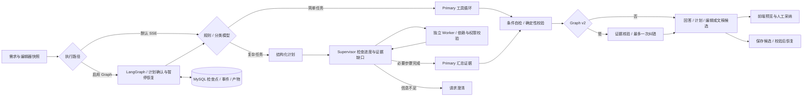
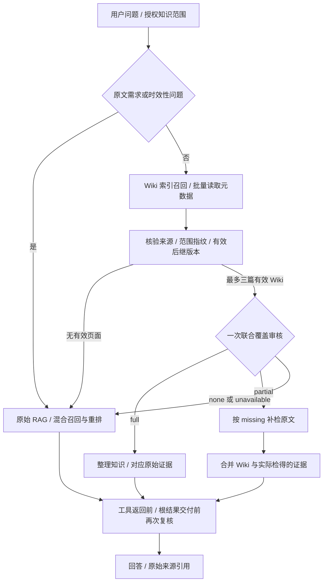
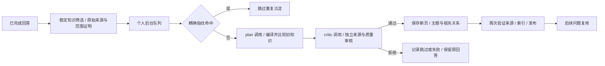

# LiveDoc NestJS Server

LiveDoc 的 TypeScript 后端，提供文档管理、资料导入、文档 Agent、**LLM Wiki + RAG** 与文章发布。默认监听 `8001`，废弃的 `../livedoc_server` 不参与运行。

[Wiki + RAG](#llm-wiki--rag-机制) · [文档 Agent](#文档-agentplan-and-execute-与-react-式执行) · [验证](#验证) · [本地运行](#本地真实组件路径)

> 历史验收：2026-10-24 的模型对照与受控回归见[交接验收记录](../docs/agent-handoff-acceptance.md)。这些记录不代表当前代码已完成真实 MySQL、页面采纳及全链路验收。基础 RAG 的配置与历史审计见[本地配置](docs/LOCAL_REAL_RAG_SETUP.md)和[质量审计](docs/RAG_PRODUCTION_QUALITY_AUDIT.md)。

## 为什么是 NestJS + Node.js

后端使用 **Node.js 20+、TypeScript、NestJS 11、Fastify 5**：NestJS 组织模块、校验与依赖注入，Fastify 处理 HTTP，Node.js 提供运行时和 Worker Thread。前后端一起运行时采用前端要求的 Node.js 22.12+。

## 文档 Agent：Plan-and-Execute 与 ReAct 式执行

`DocumentAgentService` 管理任务，Supervisor 调度步骤，Runtime 隔离 Primary、Reader 和 Researcher 的上下文与工具权限。默认使用直接 SSE 执行；开启 `AGENT_GRAPH_ENABLED=true` 后使用 LangGraph 与 MySQL 检查点，前端按能力接口选择路径。



### 路由与计划执行

- Ask / Plan / Agent 控制产出，`react / plan_execute` 控制执行策略。规则优先识别已确认计划、规划和选区任务，其余由分类模型判断；分类或自动规划失败时回退直接工具循环。
- 计划包含 `goal / outline / constraints / steps`。步骤声明依赖及 `read / search / compose` 能力；最多 5 步，实际允许步数还受循环预算限制。
- Supervisor 调度独立 Worker：Reader 读取，Researcher 检索；独立读／查最多并发 3 个，编写单独执行，最终由 Primary 汇总。编辑目标必须由 Primary 自行读取。
- Worker 交接 `findings / missing / conflicts` 及实际采用的证据，主管据此补查、澄清或汇总，并为后续步骤预留额度。
- 默认路径的 Plan 等待用户确认后发起执行；Agent 可自动规划。图任务在计划或澄清节点等待输入，确认后继续原任务；可恢复失败可由用户选择重试。

### 工具循环与权限

模型选择工具，服务端按白名单与 JSON Schema 校验后执行，再将结果交回模型。

| 类别           | 工具                                                                                                      |
| -------------- | --------------------------------------------------------------------------------------------------------- |
| 正文与参考资料 | `read_current_document`、`read_reference`，支持区域、选区与分页                                           |
| 知识检索       | `search_knowledge_base`，在授权范围内查询 Wiki 与原文                                                     |
| 写作辅助       | `list_templates`、`read_template`、`list_categories`                                                      |
| 外部资料       | 按联网开关与配置开放 `search_web`、网页读取及白名单 MCP 工具                                              |
| 结果提交       | `finish_answer`、`submit_plan`、`request_clarification`、`propose_document_edits`、`propose_new_document` |

工具按模式、资料权限与输出位置裁剪：Ask 只读，计划步骤交付中间结果，最终编写才提交候选。修改前必须读完目标；精确选区需单独读取。

协议错误允许修复一次，指定临时模型故障最多重试一次；权限、来源版本或预算失效时停止，不自动重放写入。

### 上下文、自检与人工确认

模型先接收区域目录、短预览、参考资料和适用记忆，再按需读原文。每次调用核算 Token 预算，压缩长历史时保留引用与分页信息，仍超限则要求缩小范围。

独立文稿、多条修改及深度思考结果会触发一次 Critic 自检，最多修正一次；自检失败标记 `incomplete`，候选仍需通过确定性校验。图任务 v2 另有证据核验，失败后最多进行一次修订、补查或受影响步骤重执行，再次核验后才能交付。

前端以 ProseMirror Decoration 展示差异，用户接受后才通过事务写入；手动修改目标时提示冲突，全部接受可一次撤销。

图任务 v2 还支持写作 Skill、个人偏好和会话约束。选择 `research_writing` Skill 时进入研究写作流程：生成研究任务说明、按问题收集证据、按需分章节编写，并检查覆盖度与引用；不把步骤成功等同于资料齐全。

### 事件与运行预算

| 路径       | 接口与运行方式                                                                                                 |
| ---------- | -------------------------------------------------------------------------------------------------------------- |
| 默认执行   | `POST /ai/agent` 直接返回 SSE；停止或断连取消执行，未完成任务不续跑                                            |
| 可恢复任务 | `POST /ai/agent/runs` 创建后台任务，`GET /ai/agent/runs/:id/events?after_seq=...` 订阅事件；断开订阅不取消执行 |

事件包含计划、步骤、工具、自检与候选，带 `run_id` 和递增 `seq`。默认路径的回答／文稿在候选校验后分段发送。

以下为代码默认值，实际配置以 `.env` 为准：

| 配置                         | 默认值 | 用途                                                                     |
| ---------------------------- | ------ | ------------------------------------------------------------------------ |
| `AGENT_MAX_TOOL_CALLS`       | 24     | 根任务共享执行轮数；常规 Worker 最多 4 轮，研究写作 Researcher 最多 8 轮 |
| `AGENT_TIMEOUT_SECONDS`      | 300    | 任务执行时限（秒）                                                       |
| `AGENT_MAX_OUTPUT_TOKENS`    | 4096   | 默认单次模型输出上限                                                     |
| `AGENT_MAX_TOTAL_TOKENS`     | 120000 | 累计 Token 额度                                                          |
| `AGENT_MAX_MODEL_REQUESTS`   | 30     | 累计模型请求上限                                                         |
| `AGENT_FINALIZATION_TOKENS`  | 8192   | 最终交付预留，另预留两次请求                                             |
| `AGENT_MAX_CONCURRENT_RUNS`  | 6      | 执行任务并发上限                                                         |
| `AGENT_GRAPH_ENABLED`        | false  | 启用 MySQL 可恢复任务                                                    |
| `AGENT_GRAPH_VERSION`        | v2     | 新任务工作流版本，可设为 v1                                              |
| `AGENT_GRAPH_RETENTION_DAYS` | 7      | 可恢复任务保留窗口（天）                                                 |

分类、主管、压缩、自检等调用共享累计预算；未知用量按估算扣账，不等于供应商账单。角色模型可通过 `AGENT_CLASSIFIER_MODEL / AGENT_PLAN_MODEL / AGENT_CRITIC_MODEL` 配置，留空复用主模型。

### 结果恢复与调用追踪

默认路径保存已校验候选与引用；浏览器会话记录最近运行 ID。恢复时重查权限、版本和 Wiki 证明，待采纳修改还要求正文快照一致。

| 接口                             | 用途                                  |
| -------------------------------- | ------------------------------------- |
| `GET /ai/agent/:id`              | 查询审计元数据                        |
| `POST /ai/agent/:id/restore`     | 携带 `{editor_json}` 恢复默认路径结果 |
| `GET /ai/tool-audits?run_id=...` | 查询工具与模型调用追踪                |
| `GET /ai/agent/runs/:id`         | 查询图任务状态与可恢复能力            |
| `POST /ai/agent/runs/:id/pause`  | 请求在执行边界暂停                    |
| `POST /ai/agent/runs/:id/resume` | 继续、确认／修订计划或回答澄清        |
| `POST /ai/agent/runs/:id/stop`   | 停止图任务                            |

图任务要求 `METADATA_STORE=mysql` 并执行 `npm run db:migrate`，检查点、事件与产物持久化到 MySQL。控制请求携带 `request_id / expected_revision`，等待输入时还需匹配等待项；恢复受保留窗口、任务版本与来源校验约束。租约过期的运行转为 `interrupted`，由用户继续，避免宣称重启后自动续跑。

默认路径数据库降级为内存时不能跨重启恢复。调用追踪保存耗时、模型、用量和版本哈希，不保存提示词、工具正文或凭证。

源码：[默认编排](src/ai/document-agent.service.ts)、[Supervisor](src/ai/agent-supervisor.service.ts)、[Worker](src/ai/agent-runtime.service.ts)、[图工作流](src/ai/graph/agent-graph.workflow.ts)、[检查点](src/ai/graph/mysql-checkpoint-saver.ts)、[证据核验](src/ai/evidence-verification.service.ts)、[研究写作](src/ai/research-writing.service.ts)。使用说明见[文档 Agent](docs/document-agent.md)和[前端 README](https://github.com/seren-spark/livedoc/blob/master/README.md#文档-agentplan-and-execute-与工具执行)。

## LLM Wiki + RAG 机制

原始 RAG 检索证据，个人 LLM Wiki 复用审核后的稳定知识。两层统一通过 `search_knowledge_base` 调用，引用仍指向原文。

| 层次      | 存储与职责                                                                      |
| --------- | ------------------------------------------------------------------------------- |
| 原始资料  | `knowledge_documents` 保存文档与版本，Qdrant 保存分块索引，用于查原文与补充缺口 |
| 个人 Wiki | `wiki_pages` 保存知识、来源与祖先版本，独立 Wiki 索引用于复用与覆盖判断         |

Wiki 按用户和空间隔离，普通原文检索排除 Wiki 层。

### 查询链路：联合覆盖与缺失补检



1. **定范围**：记录授权范围指纹；原文／时效需求、`original_only=true` 或无有效指纹时直接查原文。
2. **查 Wiki**：核验用户、空间、状态、来源版本与片段哈希，优先有效主题后继页。
3. **判覆盖**：最多三篇联合审核。`full` 返回知识与原始证据，`partial` 按 `missing` 补查并合并，`none / unavailable` 回退原文。
4. **交付复核**：来源失效或内容超窗时仅返回原文；缺失证据明确说明，不宣称已补齐。

Wiki 查询与覆盖检查最多占 15 秒，为原文检索预留时间。取消或根预算耗尽时停止。

### 沉淀链路：完成回答后的后台编译与审核



仅沉淀已完成、适合稳定复用且全部引用可追溯知识文档的回答；当前快照、网页摘要和时效性回答不直接入库。

`plan` 角色编译主题与限制，`critic` 角色另发请求核验来源、引用和质量，可使用同一或不同模型。通过后按 `draft → indexing → published` 保存、建索引并复核来源。

队列在进程内按用户串行，状态记录于 `agent_runs.payload.wiki_capture`；失败不影响已完成回答，也不修改原始资料。

### 知识演进：精确判重、语义判重与主题补充

先按规范化回答、稳定来源坐标与范围指纹精确判重，再比较同一有效范围中的相关 Wiki：

| 关系          | 处理方式                                                 |
| ------------- | -------------------------------------------------------- |
| `duplicate`   | 编译与审核均确认事实、限制及来源已覆盖，复用旧页         |
| `supplement`  | 保留旧正文与引用，追加有据内容，整体审核后生成新主题版本 |
| `independent` | 主体、条件或主题不同，单独保存                           |
| `conflict`    | 两轮确认同条件下冲突后，停止旧知识复用并回查原文         |

新页记录实际依赖的祖先，旧正文保持不变。仅来源相同不足以判重，超出来源或上下文预算时跳过沉淀。

### 权限、范围变化与错误反馈

- **来源校验**：检查文档权限、版本、片段坐标与哈希，以及当前资料范围；工具返回和最终交付前再次核验。
- **范围变化**：新增、更新、删除、撤权或范围变化使旧知识停止复用；缺少范围快照的旧页同样回退原文。
- **错误反馈**：`incorrect` 取消该回答的待完成沉淀，撤回其产生或直接使用的 Wiki，并使相关派生版本失效，保留原始资料。
- **失效拦截**：先改变页面状态，再清理向量；向量清理失败也不能绕过读取校验。

### 存储、审计与当前边界

| 数据                              | 内容                                                 |
| --------------------------------- | ---------------------------------------------------- |
| `wiki_pages.payload`              | 知识、来源证明、范围快照、主题／祖先关系、审核与用量 |
| Wiki 向量索引                     | `knowledge_layer=wiki`，与原文隔离                   |
| `agent_runs.payload.wiki_capture` | 后台沉淀状态与原因                                   |
| 工具审计                          | Wiki 命中、覆盖度、缺失项与回退原因                  |

每次最多三篇联合覆盖、一次相关主题比较。后台队列位于进程内，重启不续跑；暂不支持全库自动重编、分布式沉淀调度或自动解决所有冲突。前端通过引用与回答反馈参与，无独立 Wiki 管理入口。

源码：[Wiki 服务](src/wiki/wiki.service.ts)、[检索工具](src/ai/document-agent-tools.service.ts)、[存储](src/wiki/wiki.repository.ts)、[索引隔离](src/retrieval/vector-store.service.ts)。已有库升级前备份，按[迁移说明](docs/document-agent.md#个人-llm-wiki--rag)执行 `npm run db:migrate:wiki`。

验收记录：[后台沉淀](../docs/wiki-auto-capture-acceptance.md)、[来源审核](../docs/wiki-quality-acceptance.md)、[派生纠错](../docs/wiki-evolution-acceptance.md)、[知识补充](../docs/wiki-consolidation-acceptance.md)、[联合检索](../docs/wiki-retrieval-acceptance.md)。

## 模块边界

| 模块                        | 职责                                                    |
| --------------------------- | ------------------------------------------------------- |
| Auth                        | 开发账号、密码与会话、资料访问控制                      |
| Documents / Workspace       | 文档与版本、分类、模板、回收站                          |
| DocumentImports             | PDF / DOCX 解析、OCR、预览确认与资产管理                |
| Indexing                    | MySQL 索引队列、租约、重试与版本激活                    |
| Retrieval                   | Markdown 分块、Dense / Sparse 召回、RRF、BGE 重排与引用 |
| AiWriter / DocumentAgent    | 问答、Supervisor / Worker、候选与预算校验               |
| AgentGraph                  | LangGraph 检查点、任务控制、证据核验与研究写作          |
| WritingSkills / Preferences | 写作 Skill 与个人偏好                                   |
| Wiki                        | 稳定知识编译、审核、复用与失效                          |
| Articles / Observability    | 发布与互动；追踪、反馈与指标                            |

模型在 Worker Thread 中加载。Qdrant 使用 `dense / sparse` 命名向量，collection 由 `QDRANT_COLLECTION` 指定。分块与重新索引见[结构分块说明](docs/MARKDOWN_CHUNKING.md)。

## 验证

```powershell
npm install --cache .npm-cache
npm run config:check
npm run config:check:live
npm run type-check
npm test
npm run build
npm run validate:evals
npm run validate:agents
npm run test:agent-gates
npm run validate:e2e:real
```

正常本地运行固定读取项目根目录 `.env`，并要求 `RAG_RUNTIME_MODE=real`。缺少真实 provider、模型、数据库、Qdrant 或 LLM 配置时启动失败；memory/hash/heuristic 仅允许隔离测试注入。演示账户密码均为 `Demo@123456`：

- `alice@livedoc.local`：`team_alpha`
- `bob@livedoc.local`：`team_alpha`
- `carol@livedoc.local`：`team_beta`

### 单 Agent／多 Agent 对照评测

`npm run validate:agents` 校验五组合成题与原文绑定；`npm run eval:agents` 用真实模型对比直接执行与多步骤计划。评测采用隔离内存资料、哈希向量与本地检索，禁用 MCP 和后台 Wiki 编译。

2026-10-24 历史结果（含失败任务）：

| 模式       | 通过题数 | 合计 Token | 样本 P95  |
| ---------- | -------- | ---------- | --------- |
| 直接执行   | 4 / 5    | 55699      | 14.777 秒 |
| 多步骤执行 | 5 / 5    | 126564     | 35.936 秒 |

直接执行因条件／例外题耗尽轮数导致整体评测失败；历史受控专项为 12 套、138 项通过。这些结果用于机制对照，不代表当前生产链路或总体准确率。详见[验收记录](../docs/agent-handoff-acceptance.md)与[原始报告](../docs/agent-evaluation.json)。

图任务专项：`npm run test:graph:checkpoints` 检查检查点，`npm run test:graph:mysql` 验证真实 MySQL，`npm run verify:graph:real` 验证真实模型链路。研究写作题集用 `npm run validate:research-writing` 校验，真实评测用 `npm run eval:research-writing:real`；这些命令需分别运行，不能用历史报告代替。

## 本地真实组件路径

### 填充社区演示内容

`npm run seed:community` 校验内置语料；追加 `-- --apply` 向当前 MySQL 写入 20 个虚构用户、24 篇文章、72 条评论及互动关系，重复执行跳过已有内容。

演示邮箱如 `linzhixia@community.livedoc.local`，密码 `Demo@123456`。文章仅公开发布，不自动入知识库；`-- --verify` 核验存储与公开列表，报告写入 `data/seeding/community-latest.json`。语料见 [scripts/community](scripts/community)。

本地运行步骤：

1. 按[配置指南](docs/LOCAL_REAL_RAG_SETUP.md)准备 `.env`、MySQL、Qdrant、模型与解析环境。
2. 执行 `npm run db:migrate`、`npm run qdrant:init`、`npm run config:check:live`。
3. 执行 `npm run dev`，同时启动 API、索引 Worker 与导入 Worker。

分别调试可运行 `npm run start:dev`、`npm run worker`、`npm run worker:imports`；仅启动 API 不消费后台任务。

导入流程为上传 → 异步解析 → 编辑器预览 → 确认 → 索引。文件默认位于 `data/storage`，图片使用 `/assets/{assetId}/content`；OCR／视觉描述补入索引快照，不改正文，视觉描述失败不阻断预览。

真实运行使用 MySQL、Qdrant、Transformers.js BGE、BGE 重排及支持工具调用的模型；memory/hash/heuristic 仅供隔离测试。

## API 兼容

保留 Python 版本的 snake_case 请求/响应、认证、文档 CRUD、索引任务、`/knowledge/search`、`/ai/write`、feedback、metrics、trace 和开发 seed。DTO 使用 `whitelist + forbidNonWhitelisted`，未知字段返回 `422`；浏览器提交 `query_variants` 会被拒绝。

`POST /ai/write` 支持 JSON 和 SSE。SSE 顺序为：

```text
meta -> tool_start -> tool_result -> delta* -> citations -> done
                                      \-------------------> error
```

客户端断开会触发 `AbortController`，并向 LLM fetch 传播取消信号。

## 文章创作与发布

`/editor/draft` 编辑文章，`?articleId=...` 继续草稿，`?mode=knowledge` 编辑知识文档；`/creator/articles` 管理发布，`/synthesis` 与 `/post/:id` 公开阅读。

草稿存入 `article_drafts`，保存不影响线上正文。发布时可选择「同时加入知识库」：默认仅博客；勾选后同事务创建索引任务。公开快照存于 `knowledge_documents`，由 `published_metadata.include_in_knowledge` 控制检索，不复制进私人分类。

更新保留上次入库选择；取消入库会排除旧向量。撤回关闭公开阅读、图片与公共检索，保留草稿和原链接。文章快照仅通过 `/articles/:id/publish` 更新。

升级执行 `npm run db:migrate`，运行时需索引 Worker。真实验收：`npm run validate:articles:real`，报告位于 `data/validation/articles-latest.json`。

## 文章评论、点赞与收藏

评论可公开阅读，登录后可评论、回复、删除自己的内容、点赞与收藏。纯文本最多 1000 字；评论倒序、回复正序分页。删除原评论保留回复，撤回文章隐藏互动，重新发布恢复记录。

`article_comments / article_reactions` 保存数据，唯一键防止重复计数，收藏入口为 `/creator/favorites`。升级执行 `npm run db:migrate`；真实验收用 `npm run validate:interactions:real`，报告位于 `data/validation/article-interactions-latest.json`。

## 前端手动联调配置

前端 `.env.local` 使用：

```powershell
VITE_RAG_API_BASE_URL=http://127.0.0.1:8001
VITE_ENABLE_MOCK=false
```

## 固定语料与重排评测

冻结题集包含 18 篇合成原文、109 个 Chunk、60 道题，语料见[目录说明](evals/corpus/README.md)。

| 命令                             | 用途                                       |
| -------------------------------- | ------------------------------------------ |
| `npm run eval:protocol`          | 5 题快速集                                 |
| `npm run eval:prepare-retrieval` | 核对原文、分块与标注                       |
| `npm run eval:retrieval:fixed`   | Recall@3、MRR@3、NDCG@3 与候选池 Recall@20 |
| `npm run eval:rerank`            | 固定候选的真实 BGE 重排对照                |
| `npm run eval:answers`           | 采集 60 题回答与实际证据                   |
| `npm run eval:judge`             | 参考事实、拒答及证据支持核验               |
| `npm run eval:quality`           | 合并证据、失败归因与人工盲评               |
| `npm run eval:frameworks`        | EvalScope / MTEB / RAGAS 评测              |

框架评测先用 `npm run eval:setup` 准备独立 Python 3.12 环境，生产服务无需该评测依赖。参数、配对实验与报告见 [RAG 评测指南](docs/rag-evaluation.md)，业务结论需真实数据与人工校准。
