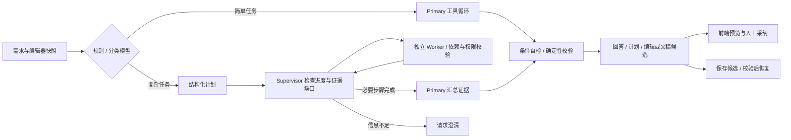
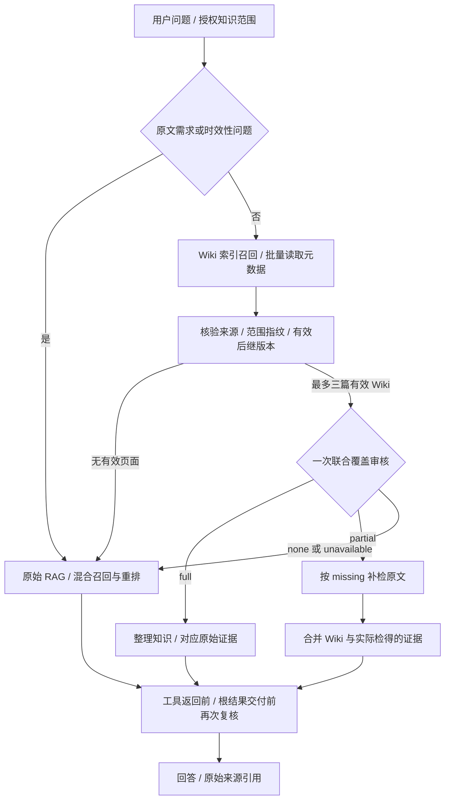
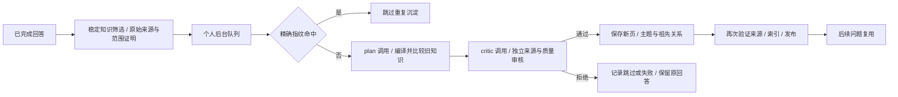

# LiveDoc NestJS Server

LiveDoc 的 TypeScript 智能文档后端，包含文档 Agent 与 **LLM Wiki + RAG**：从原始资料检索证据，将有依据的稳定回答整理为个人知识页面，后续提问优先检查整理知识、按缺口补检原文。本仓库默认监听 `8001`；废弃的 `../livedoc_server` 不参与运行，也不在本仓库的开发流程中修改。

[Wiki + RAG 机制](#llm-wiki--rag-机制) · [文档 Agent](#文档-agentplan-and-execute-与-react-式执行) · [验证与评测](#验证) · [本地运行](#本地真实组件路径)

> 验证状态（2026-10-24）：已接入结构化 Worker 交接、剩余步骤预算预留、事实原文绑定评测及 CI 回归。后端类型检查、构建与受控回归通过；五题真实模型对照的结果和失败项见 [交接与业务回归验收](../docs/agent-handoff-acceptance.md)。恢复功能已验证存储接口及重建服务实例，真实 MySQL 持久化和页面人工采纳仍待验收，本轮未重启现有服务。基础 RAG 的历史记录见 [生产质量审计](docs/RAG_PRODUCTION_QUALITY_AUDIT.md) 和 [本地真实 RAG 配置](docs/LOCAL_REAL_RAG_SETUP.md)，与本轮验收分别记录。

## 为什么是 NestJS + Node.js

NestJS 是运行在 Node.js 上的后端框架，不是与 Node.js 并列的第二个运行时。本项目的准确表述是：**Node.js 20 + TypeScript + NestJS + Fastify**。NestJS 提供 Module、Guard、DTO、Provider 和依赖注入，Fastify 提供 HTTP adapter，Node.js 提供运行时和 Worker Thread。

## 文档 Agent：Plan-and-Execute 与 ReAct 式执行

`DocumentAgentService` 负责根任务生命周期，`AgentSupervisorService` 决定分步调度，`AgentRuntimeService` 为 Primary、Reader、Researcher 提供独立的消息、证据和工具上下文。它们在同一个 API 进程内协作。Ask / Plan / Agent 控制本轮产出，`react / plan_execute` 控制执行策略；分类、规划／主管和自检可配置独立模型，默认复用主模型。



### 路由与计划执行

- `ruleRoute` 优先识别已确认计划、Plan 模式、多步骤与选区任务；其余请求交给分类模型。分类失败回退到直接工具循环，自动规划失败时同样回退，不改变资料权限与输出模式。
- `ExecutionPlan` 包含 `goal`、`outline`、`constraints` 与最多 5 个 `steps`。步骤声明 `depends_on` 和 `read / search / compose` 能力，服务端拒绝循环依赖和无效标识。
- Supervisor 通过结构化 `dispatch / supplement / compose / clarify` 决策选择下一步，服务端校验依赖、状态与权限。独立读取和检索最多并发 3 个，编写步骤单独执行；必要步骤全部成功后，最终 Primary 才汇总生成候选。
- Reader 负责读取，Researcher 负责授权范围内的检索；下游只接收成功依赖采用的引用及实际证据。最终编辑必须由 Primary 自己读取目标，不能继承其他 Worker 的编辑读取证明。
- Worker 通过 `handoff` 交接有证据的事实、缺失项和冲突，服务端校验引用来自实际观察且已采用的资料，并计算覆盖状态。主管根据结构化交付决定补查、澄清或汇总；执行成功不会自动表示资料充分。中间 compose 步骤仍需单独派发。
- 显式 Plan 模式只提交计划，用户调整并确认后携带 `confirmed_plan` 和最新快照执行；手动编辑计划按列表顺序建立依赖。Agent 模式可以自动规划并继续执行，正文仍需用户确认。
- 主管最多追加一次依赖成功步骤的补查，累计仍不超过 5 步；保留用户确认的目标、约束和原步骤。必要步骤失败时终止任务，不自动重跑整个步骤或部分交付。
- 为后续必要步骤预留调度和交接轮数，同批 Worker 平分剩余额度，并在获分配的最后一轮提交已有事实与缺口，避免并行研究耗尽汇总预算。总轮数与 Token 预算不自动增加。

### 工具循环与权限

每轮模型提交一个 Function Call；服务端按当前工具白名单与 JSON Schema 校验参数，执行并将返回值写入工具消息，供下一轮继续选择。工具参数／结果协议允许修复一次。模型限流、502／503／504 和已识别的临时网络故障最多重试一次模型请求；权限失效、来源版本变化和预算不足直接终止，不自动重放工具或写入。

| 工具类别       | 实现                                                                                                      |
| -------------- | --------------------------------------------------------------------------------------------------------- |
| 原文与参考资料 | `read_current_document`、`read_reference`，支持区域、精确选区及分页读取                                   |
| 知识检索       | `search_knowledge_base`，复用正式 RAG 与用户选择的检索范围                                                |
| 写作辅助       | `list_templates`、`read_template`、`list_categories`                                                      |
| 外部资料       | 按本轮联网开关与配置开放 `search_web`、个人联网工具及白名单 MCP 工具                                      |
| 结果提交       | `finish_answer`、`submit_plan`、`request_clarification`、`propose_document_edits`、`propose_new_document` |

工具集按模式、输出位置、资料与联网权限裁剪；Ask 不开放编辑提交，计划步骤只返回中间结果。工具扩展最多一次，仍受原权限约束。修改建议必须先读取目标区域，选区修改必须精确读取选区；工具提交候选不会直接写正文。

### 上下文、自检与人工确认

初始上下文包含文档区域目录、短预览、参考资料清单、已选知识范围、会话记忆和适用的文档记忆。每次调用前对消息与工具定义计算 Token 预算；长工具历史可压缩并保留来源及分页标识，仍超限则要求缩小范围。知识范围中的相关问题优先检索该范围，资料缺项明确说明；子任务第四轮仅开放结果／澄清工具，为提交已有事实与缺口保留机会。

独立文稿、多条修改建议，以及深度思考下的回答或编辑会触发一次 Critic 检查，关注要求遗漏、证据支持、矛盾和结构。发现问题最多修正一次，修正后执行结构校验；没有第二轮模型复审。自检异常标记为 `incomplete` 并保留候选，随后仍要通过引用、资料权限、版本与修改范围校验，再由用户核对采纳。

前端以 ProseMirror Decoration 展示候选，采纳时才通过事务写入；位置映射与原文比对检测人工修改冲突，全部接受可一次撤销。候选和文稿进入 `awaiting_review`，需要补充信息时进入 `needs_input`。

### 事件与运行预算

Agent 使用独立的 `POST /ai/agent` SSE 协议，事件包括 `run_started`、`route`、`plan`、`step`、`tool_start`、`tool_result`、`reflection`、`delta`、`result`、`done`，失败时发送 `error`。各事件带 `run_id` 和递增 `seq`；回答与文稿的 `delta` 在候选完成校验后分段发送，工具与步骤事件展示执行进度。

| 配置 | 默认值 | 作用 |
| --- | --- | --- |
| `AGENT_MAX_TOOL_CALLS` | 12 | 根任务共享执行轮数，单步另限 4 轮 |
| `AGENT_TIMEOUT_SECONDS` | 300 | 根任务总时限，单位秒 |
| `AGENT_MAX_OUTPUT_TOKENS` | 4096 | 默认单次模型最大输出 |
| `AGENT_MAX_TOTAL_TOKENS` | 120000 | 累计模型 Token 额度 |
| `AGENT_MAX_MODEL_REQUESTS` | 30 | 累计模型请求次数 |
| `AGENT_FINALIZATION_TOKENS` | 8192 | 研究阶段为最终交付预留的 Token，另预留两次模型请求 |
| `AGENT_MAX_CONCURRENT_RUNS` | 6 | 单 API 进程同时执行的根任务数 |

分类、主管、压缩、自检、Wiki 覆盖判断和内置联网搜索计入同一累计预算。并发调用发出前同步预留额度，成功后按供应商用量结算；失败、取消或缺少用量时保留估算扣账。`charged_tokens / reserved_tokens / estimated_requests` 区别于供应商实际 Token 统计，估算额度不等于精确账单。角色模型分别使用 `AGENT_CLASSIFIER_MODEL`、`AGENT_PLAN_MODEL`、`AGENT_CRITIC_MODEL`。

用户停止或连接关闭会取消执行。当前限流与名额为进程内控制，多实例共享调度及运行中步骤的断点续跑尚未实现。

### 结果恢复与调用追踪

通过校验的候选、采用引用、覆盖信息和选区描述保存到现有 `agent_runs.payload.delivery`，无需为本次 Agent 改造新增迁移。前端在当前浏览器会话中保存该文档最近一次运行 ID 与原选区位置，刷新后打开助手即可尝试恢复结果，并保留已处理建议与回答反馈状态。

- `GET /ai/agent/:id`：返回当前用户的审计元数据，不包含候选正文，来源失效后仍可查任务状态。
- `POST /ai/agent/:id/restore`：接收 `{editor_json}`，重新校验目标／来源权限、版本及 Wiki 证明；恢复待采纳修改还需正文快照哈希一致。正文变化、撤权或版本变化时要求重新生成。
- `GET /ai/tool-audits?run_id=...`：查询工具审计；`payload.traces` 记录 Supervisor、Worker、模型和工具的父子调用、耗时、模型、用量、错误码、尝试次数、提示词版本／哈希和工具 Schema 哈希。

未完成且已无本地执行任务的记录显示为 `interrupted`，不会自动续跑。数据库故障沿用内存降级并标记 `audit_store=memory`，此时结果不能跨服务重启恢复。调用追踪不保存提示词、工具正文或凭证。

源码入口：[根编排](src/ai/document-agent.service.ts)、[Supervisor](src/ai/agent-supervisor.service.ts)、[Worker Runtime](src/ai/agent-runtime.service.ts)、[预算与失败策略](src/ai/agent-execution.ts)、[结果校验](src/ai/document-agent.validation.ts)、[运行审计](src/ai/agent-audit.service.ts)。使用与可选能力配置见 [文档 Agent 说明](docs/document-agent.md)，前端交互见 [工作台 README](https://github.com/seren-spark/livedoc/blob/feat/knowledge/README.md#文档-agentplan-and-execute-与工具执行)。

## LLM Wiki + RAG 机制

系统通过同一个 `search_knowledge_base` 工具组织两层知识：原始 RAG 负责召回文档证据，个人 LLM Wiki 保存经编译、审核的稳定事实与限制条件。查询链路根据覆盖度决定复用或补检，已完成回答再异步参与下一轮知识沉淀。

| 层次 | 数据与索引 | 职责 |
| --- | --- | --- |
| 原始资料 | `knowledge_documents` 中的文档及版本，Qdrant 中的原文分块 | 提供可追溯事实，支持新问题、缺口补检、原文核实和时效性查询 |
| 个人 Wiki | `wiki_pages` 中的正文、来源证明、主题与祖先版本，标记 `knowledge_layer=wiki` 的索引 | 复用整理后的知识，联合判断问题覆盖度，保留原始来源与适用条件 |

Wiki 索引按用户和空间隔离，普通原文检索排除 Wiki 层。命中 Wiki 时仍返回原始来源片段和引用，供最终回答核对证据。

### 查询链路：联合覆盖与缺失补检



1. **确定范围与读取策略**：根任务记录授权知识范围的元数据指纹。明确要求原文、需要最新资料，或 Worker 已检查过 Wiki 后要求 `original_only=true` 时，走原始检索；初始范围指纹不可用时跳过 Wiki 复用与自动沉淀。
2. **召回有效 Wiki**：直接从 Wiki 索引召回并批量读取元数据，校验用户／空间、发布状态、来源权限及版本、片段哈希和范围指纹；存在有效主题后继页时优先采用后继。检索不受管理列表最近 100 条的限制。
3. **联合判断覆盖度**：最多选择三篇、受共同上下文预算约束的页面，使用一次审核判断其联合内容。输入包含用户问题、检索词和整理知识，输出 `coverage / missing`；检索词不增加用户实际要求，同义改写或只问已有知识的子集不构成缺失。
4. **按结果组织证据**：`full` 直接返回整理知识及其原始证据；`partial` 将缺失项加入原查询，在相同授权范围补检原文，再合并可用证据；`none / unavailable` 走原始 RAG。未检得的内容继续标为缺失，不能声明缺口已经补齐。
5. **交付前再次核验**：补检期间 Wiki 失效或合并内容超出上下文容量时，只返回原文结果。工具返回前和根任务最终输出前复核所有采用的 Wiki；引用按来源坐标重绑定，避免不同历史回答中的同名引用串到错误证据。

Wiki 查询与覆盖检查合计最多 15 秒，为现有 30 秒工具期限保留原文检索时间。Wiki 异常、超时或内容超过上下文容量会回退原文；用户取消时停止，不启动补检。根任务累计预算不足直接终止，原文检索失败按工具失败处理。

例如，已有 Wiki 仅覆盖交付日期，用户同时询问交付日期和验收负责人。审核将“验收负责人”列入 `missing`，再检索授权原文并分别引用两项证据；如果另一篇有效 Wiki 已覆盖负责人，两篇即可联合满足问题。

### 沉淀链路：完成回答后的后台编译与审核



自动沉淀由根任务的已完成知识回答触发。`WikiService.origin()` 只接收全部引用来自可追溯知识文档、适合稳定复用且满足来源／长度预算的回答，记录问题、回答指纹、来源坐标与片段哈希、知识范围快照及实际使用的 Wiki 祖先。网页摘要、当前编辑快照、缺少原始来源的内容和时效性回答不会直接进入自动沉淀。

编译使用 `plan` 角色调用，将回答已经陈述且原文明确支持的事实整理成主题页，保留限制和引用；`critic` 角色另发一次独立审核请求，核验来源支持、引用和限制条件，并检查 `reusable / complete / substantive`。两轮可配置不同模型，也可以复用同一模型；独立审核通过后才保存并索引，不把模型审核视为用户认可。

发布先检查来源与候选版本，经 `draft → indexing → published` 状态转换建立索引，再次检查来源和状态。后台使用按用户串行的进程内队列，编译结果记录在 `agent_runs.payload.wiki_capture`；沉淀失败不改写已完成回答的终态，不需要用户额外确认或修改原始资料。

### 知识演进：精确判重、语义判重与主题补充

精确判重使用规范化回答、稳定来源坐标及知识范围指纹；后台按哈希直接查询。相同来源片段仍可能支持不同事实，因此只有来源相同不能判定重复。

对于同一有效范围中的一篇相关 Wiki，编译与独立审核分别判断 `duplicate / supplement / independent / conflict`：

| 关系 | 处理方式 |
| --- | --- |
| `duplicate` | 两轮都确认旧正文已覆盖全部事实及限制，且本轮来源证明已包含在旧页中时，复用旧页并记录 `semantic_duplicate`；更短问法、同义改写和旧知识子集也可以复用 |
| `supplement` | 保留旧正文及重新绑定的引用，追加有原文支持的兼容增量，再审核完整合并结果；生成新页，以 `topic_id / supersedes` 连接主题版本 |
| `independent` | 主体、项目、条件或主题不同，作为独立页面保存；标题或向量相近不足以合并 |
| `conflict` | 同条件下结论冲突经两轮确认后标记旧知识，停止直接复用并回到原文核实 |

新页保存实际依赖的祖先版本，旧正文保持不可变。补充不能靠截断旧知识通过预算或审核；来源、长度或上下文条件不满足时停止本次沉淀。

### 权限、范围变化与错误反馈

- **来源证明**：保存文档 ID、版本、片段起止坐标与哈希；每个贡献来源都必须仍可访问，并符合用户本轮选择的范围。
- **范围指纹**：检测授权元数据集合的变化。文档新增、更新、删除、撤权或知识范围变化时，旧 Wiki 停止复用并回退原文；没有快照的旧页同样不复用。
- **派生纠错**：用户通过现有反馈接口提交 `incorrect` 时，取消该回答进行中的沉淀，撤回其产生或直接使用的 Wiki，并沿对应祖先版本使派生页失效；独立原文整理页和原始资料保留。
- **读取时拦截**：撤回先改变页面状态，后清理向量；即使向量清理暂时失败，来源与状态校验仍阻止失效知识再次返回。根回答保持原终态，前端展示已记录的错误反馈。

### 存储、审计与当前边界

| 数据 | 主要内容 |
| --- | --- |
| `wiki_pages.payload` | 知识正文、`sources`、`knowledge_snapshot`、`parents`、`topic_id / supersedes`、审核结果与用量 |
| Wiki 向量索引 | `knowledge_layer=wiki`，按空间和个人权限召回，与原文检索隔离 |
| `agent_runs.payload.wiki_capture` | 后台运行、发布、跳过、失败及原因，不覆盖根回答状态 |
| 工具审计 | `wiki_ids / query / coverage / missing / reason` 与 `wiki_fallback`，用于定位覆盖判断和回退行为 |

当前每次最多三篇联合覆盖、一次相关主题比较；后台队列重启不续跑。范围指纹负责检测变化，尚不提供全库自动重编、分布式沉淀调度或自动解决所有事实冲突。前端通过原有问题、引用与回答反馈参与流程，不提供独立 Wiki 管理入口。

源码入口：[Wiki 编译／审核／检索](src/wiki/wiki.service.ts)、[原文补检与证据交付](src/ai/document-agent-tools.service.ts)、[来源与版本类型](src/wiki/wiki.types.ts)、[元数据存储](src/wiki/wiki.repository.ts)、[索引层隔离](src/retrieval/vector-store.service.ts)。首次部署按 [文档 Agent 说明](docs/document-agent.md#个人-llm-wiki--rag) 执行备份与 `npm run db:migrate:wiki` 专用增量迁移。

验收分别记录，避免把受控测试或真实模型专项结果视为全链路上线完成：[后台沉淀](../docs/wiki-auto-capture-acceptance.md)、[来源审核与补检](../docs/wiki-quality-acceptance.md)、[范围变化与派生纠错](../docs/wiki-evolution-acceptance.md)、[语义判重与补充](../docs/wiki-consolidation-acceptance.md)、[检索与联合覆盖](../docs/wiki-retrieval-acceptance.md)。

## 模块边界

- `Auth`：开发身份、PBKDF2 密码、Bearer session、Guard。
- `Documents`：权限感知的文档 CRUD、版本和索引状态。
- `DocumentImports`：PDF/DOCX 持久化导入队列、Docling 解析、图片 OCR/视觉描述、预览确认与资产生命周期。
- `Indexing`：MySQL 任务队列、事务领取、`SKIP LOCKED`、租约回收、重试与版本激活。
- `Retrieval`：Markdown AST 分块、Transformers.js embedding、Jieba + Qdrant IDF sparse、Dense + Sparse、RRF、BGE rerank、去重、压缩与引用。
- 分块与压缩规则、原文定位字段及已有文档重新索引说明见 [Markdown 结构分块](docs/MARKDOWN_CHUNKING.md)。
- `AiWriter`：受约束 Typed Tool Registry、OpenAI-compatible Function Calling、会话记忆、普通 JSON 与 SSE。
- `DocumentAgent`：Supervisor／独立 Worker、角色工具权限、证据交接、候选校验、累计预算、调用追踪与结果恢复。
- `Wiki`：个人整理知识的后台编译、审核、来源证明、联合覆盖检查及原文补检。
- `Observability`：trace、feedback、检索/生成延迟、采用率和队列深度。

模型加载位于独立 Worker Thread。Qdrant 使用命名向量 `dense` / `sparse`，collection 由 `.env` 的 `QDRANT_COLLECTION` 指定。

## 验证

```powershell
npm install --cache .npm-cache
npm run config:check
npm run config:check:live
npm run type-check
npm test
npm run build
npm run validate:evals
npm run validate:agents
npm run test:agent-gates
npm run validate:e2e:real
```

正常本地运行固定读取项目根目录 `.env`，并要求 `RAG_RUNTIME_MODE=real`。缺少真实 provider、模型、数据库、Qdrant 或 LLM 配置时启动失败；memory/hash/heuristic 仅允许隔离测试注入。演示账户密码均为 `Demo@123456`：

- `alice@livedoc.local`：`team_alpha`
- `bob@livedoc.local`：`team_alpha`
- `carol@livedoc.local`：`team_beta`

### 单 Agent／多 Agent 对照评测

`npm run validate:agents` 检查五组固定合成问题及事实原文绑定；`npm run eval:agents` 调用已配置的真实模型，对同一问题分别运行直接执行与已确认多步骤计划。除完成状态外，还检查事实同行引用对应原文、授权范围、冲突／缺失说明及禁止编造的金额。评测强制数据库、向量和记忆使用隔离内存数据，禁用 MCP 与后台 Wiki 编译，仅发送新建合成资料。报告保存在工作区父目录的 [docs/agent-evaluation.json](../docs/agent-evaluation.json)。

`npm run test:agent-gates` 提供无需模型凭证的业务回归，覆盖结构化交接、权限、预算、主管调度、补查、取消、恢复与 Wiki 失效。GitHub Actions 在 push／PR 执行此回归、类型检查、构建和题集校验；真实模型评测单独执行。确定性证据绑定检查不能代替完整语义支持率及用户采纳评测。

2026-10-24 的五题覆盖事实查询、资料冲突、资料缺项、条件／例外及多层依赖汇总；以下用量与 P95 包含失败任务：

| 模式 | 事实原文绑定等检查 | 五题合计 Token | 本次样本 P95 |
| --- | --- | --- | --- |
| 直接执行 | 4 / 5 通过 | 55699 | 14.777 秒 |
| 多步骤执行 | 5 / 5 通过 | 126564 | 35.936 秒 |

直接执行的条件／例外题达到轮数上限，评测整体返回失败；没有删除该题或放宽标准。早前轮次还暴露主管提前汇总、研究耗尽后续预算及缺失项引用遗漏，均保留报告。最新多步骤五题通过不表示总体效果稳定，也不能推出整体准确率提升。评测使用哈希向量和本地检索，不代表生产 MySQL／Qdrant 验收。后端受控专项 12 套、138 项通过，具体结果和剩余边界见 [交接与业务回归验收](../docs/agent-handoff-acceptance.md)。

## 本地真实组件路径

### 填充社区演示内容

`npm run seed:community` 只校验内置语料；`npm run seed:community -- --apply` 向当前 `.env` 指定的 MySQL 新增 20 个虚构演示用户、24 篇完整文章、72 条主题相关评论（含作者回复）以及适量点赞／收藏关系。正文每篇约 1,100～1,350 个中文字，涵盖前端、后端、AI／RAG、数据库、运维、写作与测试。稳定标识保证重复执行跳过已有文章，保留后续人工编辑；不覆盖既有用户和内容，不执行迁移或清库。

演示账户邮箱为 `<用户名拼音>@community.livedoc.local`，例如 `linzhixia@community.livedoc.local`，密码 `Demo@123456`。全部身份和讨论均为演示数据，来源位于 [scripts/community](scripts/community)。文章作为公开博客发布，不自动加入知识库或触发向量索引。`npm run seed:community -- --verify` 通过公开列表／详情使用的业务服务复核真实存储与分页可见性，报告写入 `data/seeding/community-latest.json`。

1. 按 [LOCAL_REAL_RAG_SETUP.md](docs/LOCAL_REAL_RAG_SETUP.md) 配置项目根目录 `.env`。
2. 执行 `npm run db:migrate`、`npm run qdrant:init` 和 `npm run config:check:live`。
3. 本地开发执行 `npm run dev`，一次启动 API、索引 worker 和导入 worker。

如需分别调试三个进程，可在三个终端依次运行 `npm run start:dev`、`npm run worker`、`npm run worker:imports`。只启动 API 不会消费索引任务，文档会保持 `queued`。

知识文档导入按“上传 → 异步解析 → `/editor/draft` 预览修改 → 确认 → 索引”执行。源文件和图片默认位于 `data/storage`，正文只保存稳定的 `/assets/{assetId}/content` 地址；图片 OCR/描述只在索引快照中追加，不写回编辑器正文。视觉描述未配置或失败不会阻断预览确认。

生产模式会拒绝 memory/hash/heuristic/rule fallback，并要求 MySQL、Qdrant、Transformers.js BGE、BGE reranker、LLM Function Calling 和 API key 全部配置。

## API 兼容

保留 Python 版本的 snake_case 请求/响应、认证、文档 CRUD、索引任务、`/knowledge/search`、`/ai/write`、feedback、metrics、trace 和开发 seed。DTO 使用 `whitelist + forbidNonWhitelisted`，未知字段返回 `422`；浏览器提交 `query_variants` 会被拒绝。

`POST /ai/write` 支持 JSON 和 SSE。SSE 顺序为：

```text
meta -> tool_start -> tool_result -> delta* -> citations -> done
                                      \-------------------> error
```

客户端断开会触发 `AbortController`，并向 LLM fetch 传播取消信号。

## 文章创作与发布

`/editor/draft` 为文章模式，`?articleId=...` 继续编辑已有草稿；知识库模式仍使用 `?mode=knowledge`。
`/creator/articles` 管理草稿、已发布和已撤回文章，`/synthesis` 展示公开文章，`/post/:id` 支持匿名图文阅读。

草稿单独保存在 `article_drafts`，保存不修改线上正文。发布弹窗提供“同时加入知识库”：新文章默认不勾选，仅发布为可公开阅读的博客；勾选后在同一 MySQL 事务中自动创建索引任务，由后台 Worker 完成知识检索同步，无需用户再点击索引。
公开快照仍存放在 `knowledge_documents`，是否参与检索由 `published_metadata.include_in_knowledge` 控制，不会复制到个人私有分类目录。更新发布保留上次选择；已有文章缺少该字段时保留原来的入库行为。取消勾选会取消未完成任务并排除旧向量，但不影响公开图文阅读。
撤回关闭公开详情、图片和公共检索，保留草稿与原链接。文章快照必须通过 `/articles/:id/publish` 更新；通用文档写入接口拒绝修改它。

升级后执行 `npm run db:migrate`。正常开发使用 `npm run dev` 同时启动 API 和索引 worker，仅启动 API 时文章可以阅读，检索任务会保持排队。
真实验收执行 `npm run validate:articles:real`，覆盖持久化、仅博客发布、勾选后真实索引检索、更新、撤回、再次发布及取消／重新加入知识库。
脚本只领取本次文章的索引任务，结束后清理本次临时文章及图片，报告保存到 `data/validation/articles-latest.json`。

## 文章评论、点赞与收藏

文章详情支持公开阅读评论，登录后发表评论、删除自己的评论、点赞及取消点赞、收藏及取消收藏。
评论和回复为纯文本，最多 1000 字。评论按时间倒序分页，每条评论的回复可展开并按时间正序分页；总数包含回复。删除原评论会清空正文并保留已有回复，删除自己的回复不影响其他人。`/creator/favorites` 展示当前账号的收藏，创作者中心和文章互动区都提供入口。
`article_comments` 与 `article_reactions` 保存真实数据，点赞和收藏使用用户与文章的唯一键防止重复计数。首页展示真实互动数量。
撤回文章时隐藏评论和收藏入口，重新发布恢复原记录；永久删除旧版文档时清理相关互动。

升级执行 `npm run db:migrate`。真实验收使用 `npm run validate:interactions:real`，报告位于 `data/validation/article-interactions-latest.json`，默认清理本次临时文章。

## 前端手动联调配置

前端 `.env.local` 使用：

```powershell
VITE_RAG_API_BASE_URL=http://127.0.0.1:8001
VITE_ENABLE_MOCK=false
```

## 固定语料与重排评测

已将 LearnHub 的冻结题集、实际证据核验、同题配对实验思路接入 NestJS 评测链路。使用 `npm run eval:protocol` 跑 5 题快速集，`npm run eval:rerank` 对固定候选调用真实 BGE 重排，`npm run eval:judge` 可进一步核验答案是否超出资料；原有 `npm run validate:real` 的 60 题集继续可用。题集标注、初始化、续跑、对比和结果说明见 [RAG 评测指南](docs/rag-evaluation.md)。

官方框架评测：`npm run eval:setup` 安装独立的 Python 3.12 评测环境，再执行 `npm run eval:frameworks -- --report <真实回答报告路径>`。EvalScope 调度 MTEB 的 Embedding／BGE 重排和 RAGAS 的五项生成质量指标，保存原始结果、输入哈希与模型调用记录。生产服务无需 Python 评测依赖。

第一阶段检索回归使用18篇约1100—1300字的长文、109个冻结 Chunk 和60题标注。`npm run eval:prepare-retrieval` 核对原文与分块，`npm run eval:retrieval:fixed` 计算 Chunk Recall@3、MRR@3、NDCG@3、重排前候选池 Recall@20 并保留失败样例；`--mode` 与 `--no-rerank` 支持策略对比。原文目录见 [长文语料](evals/corpus/README.md)。

第二阶段使用`npm run eval:answers`运行60题实际问答，`eval:judge -- --references evals/rag_references.json`评分语义事实覆盖、Correctness和拒答行为，`eval:frameworks -- --stage ragas --metrics core`通过官方EvalScope/RAGAS评分Faithfulness和FactualCorrectness。`eval:quality`合并本轮实际检索证据、失败归因和待人工填写的盲评表；空表明确保留人工校准pending。基础专项回归已覆盖权限、无依据拒答与索引版本污染，完整CI门禁仍需业务数据和人工校准后确定。完整命令见[RAG评测指南](docs/rag-evaluation.md)。
