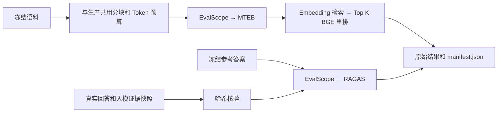
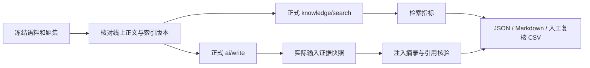

# LiveDoc RAG 评测

评测链路包括 LiveDoc 业务专项检查和官方框架评测。保留原有 18 篇语料／60 道题，增加 3 篇合成语料／5 道题的快速验证集，以及 4 道固定候选的重排实验。EvalScope 调度 MTEB 检索／重排和 RAGAS 生成质量评测；Python 仅运行离线评测，生产服务继续使用 NestJS。

参考阅读：[LearnHub 评测工具说明](https://github.com/luyiyanyumu/LearnHub/blob/master/tools/README.md)、[固定知识库评测实现](https://github.com/luyiyanyumu/LearnHub/blob/master/tools/run-fixed-kb-eval.mjs)、[重排配对实验](https://github.com/luyiyanyumu/LearnHub/blob/master/tools/run-rerank-ab.mjs)、[答案依据核验](https://github.com/luyiyanyumu/LearnHub/blob/master/backend/src/main/java/org/dyh/learnhub/service/GroundingService.java)。本项目按自己的 API、权限模型和推理服务实现。

## EvalScope + MTEB + RAGAS

固定版本为 EvalScope 1.13.0、MTEB 2.26.12、RAGAS 0.4.3。Windows 环境使用 Python 3.12，全部传递依赖保存在 `evals/requirements-frameworks.windows.lock.txt`，独立环境位于 `evals/.venv/`。安装一次后可直接复跑。

```powershell
npm run eval:setup
# 已有真实回答报告时，直接执行下一条；首次使用先采集：
npm run eval:protocol -- --seed-eval --run-dir evals/results/protocol-v1
npm run eval:frameworks -- --report evals/results/protocol-v1/report.json
```

若没有注册 Python 3.12，可用 `npm run eval:setup -- -Python "完整的 Python 3.12 路径"` 指定。Linux 可手动建立 `evals/.venv` 并安装 `evals/requirements-frameworks.txt`；本次实际验证平台为 Windows。运行需要现有真实模型配置，生成核验会产生模型调用费用。



MTEB 使用真正的 Chunk ID、公开语料和问题相关性标注，计算 NDCG、Recall、MRR；它评测的是模型检索和重排，不包含生产链路的混合召回、查询扩展、MMR 或权限过滤。`--top-k` 控制进入重排的候选数，默认 5；原始 MTEB 结果包含其标准截断点指标。权限和无证据拒答由 LiveDoc 原业务检查覆盖。

默认从题集 `evidence_groups` 的原文摘录映射到完整 Chunk；同一来源的多个摘录可以由多个片段共同覆盖，任一必要摘录无法映射时拒绝评测，需核对原文或补充人工 `chunk_qrels: [{chunk_id, score}]`，支持 0–3 级。只有文档 ID 或关键词不能推断 Chunk 相关性。MTEB 的相关 Chunk 排名指标不等于“所有必要证据组均已满足”，后者继续由专项评测检查。

RAGAS 仅接受已完成回答、核验通过的实际入模证据和对应问题的完整参考答案，运行 Faithfulness、AnswerRelevancy、ContextPrecision、ContextRecall、FactualCorrectness 五项官方指标。默认参考答案是 `evals/protocol_references.json` 中的合成验收标注，正式业务题集仍需业务人员复核。无证据拒答不混入这五项生成指标，跳过原因逐项记录；没有标注的旧 60 题不会自动生成虚假标准答案。

客户端适配：RAGAS 0.4.3 依赖的 VertexAI 导入要求固定 `langchain-community==0.4.1`；EvalScope 1.13.0 的默认 Embedding 客户端与旧指标接口不一致，因此在单次 RAGAS 调用内绑定官方 `LangchainLLMWrapper` 和 `LangchainEmbeddingsWrapper`，调用结束恢复原绑定。未修改依赖包文件、指标实现或评分算法。

模型适配器临时监听 `127.0.0.1` 随机端口，使用本次随机令牌，结束后关闭。Embedding 和重排调用现有真实推理 Worker；核验模型沿用 `AGENT_CRITIC_MODEL`，为空时复用主模型。真实供应商密钥只留在 Node 进程，框架配置使用临时本地令牌，落盘日志最终清除此令牌。不会保存原始推理链。

支持 `--stage export|mteb|ragas|all`，默认 all；`--corpus` 和 `--references` 可指定自定义语料与参考答案。每次使用新的 `--out` 目录，默认自动生成，避免覆盖已有实验。

输出包括 `manifest.json`（版本、输入哈希、配置、各阶段有效指标和实际模型调用次数）、`retrieval/*.jsonl`（MTEB 数据）、`chunks.json`、`ragas.json`、`ragas_score.json` 和 `evalscope-mteb/`、`evalscope-ragas/` 原始框架产物。缺少结果、样本数量不符或核心分数无效时失败退出。极小题集的 MTEB nAUC 可能未定义，保留原始结果，摘要只汇总有效的排名指标。

2026-10-19 实际框架接入验收保存于 `evals/results/frameworks-integration-v4/`：MTEB 3 个问题／2 个公共 Chunk，Embedding 和 BGE 阶段 NDCG@5、Recall@5、MRR@5 均为 1.000；RAGAS 4 个回答的 Faithfulness 1.000、AnswerRelevancy 0.791、ContextPrecision 1.000、ContextRecall 1.000、FactualCorrectness F1 0.893。实际调用 Embedding 10 次、BGE 3 次、核验模型 39 次。题集很小且为合成内容，这些分数用于验证框架链路，不证明真实业务准确率或重排收益。

## 评什么

第一阶段固定检索回归使用 `evals/rag_corpus.jsonl` 的18篇合成长文、`evals/rag_cases.jsonl` 的60道题和 `evals/rag_chunks.json` 的冻结分块。可读原文位于 `evals/corpus/`，每篇约1100—1300字，长文版 `retrieval-v2-longform` 共109个 Chunk，使用新的 `_v2` 文档ID。44道有授权证据的问题逐题标注了相关 Chunk 和原文证据组；8道无依据题、8道越权题明确标注为空，不进入相关性指标平均值，也不被计为满分。标注状态为合成语料整理，尚不代表经过业务人员复核的真实业务数据。

```powershell
# 核验冻结 Chunk 与真实生产 tokenizer 一致；变更分块后需人工核对并显式 --write。
npm run eval:prepare-retrieval
npm run eval:retrieval:fixed -- --validate-only

# 首次创建或核验 eval_ 文档，等待真实索引；后续实验不再 seed。
npm run eval:retrieval:fixed -- --seed-eval --mode keyword --no-rerank --run-dir evals/results/stage1-v2-keyword
npm run eval:retrieval:fixed -- --mode dense --no-rerank --run-dir evals/results/stage1-v2-dense
npm run eval:retrieval:fixed -- --mode hybrid --no-rerank --run-dir evals/results/stage1-v2-hybrid
npm run eval:retrieval:fixed -- --mode hybrid --run-dir evals/results/stage1-v2-hybrid-bge
npm run eval:compare -- --baseline evals/results/stage1-v2-hybrid/report.json --candidate evals/results/stage1-v2-hybrid-bge/report.json --output evals/results/stage1-v2-hybrid-vs-bge.json
```

固定协议关闭 LLM 查询扩展，明确记录 `mode`、`rerank`、top-k=3 和候选池截断20。关键词／向量／混合三个实验均可关闭 BGE，重排实验在相同混合召回基础上只开启 BGE，避免同时改变多个因素。它们调用正式 `/knowledge/search`，继续使用服务端身份、范围和当前索引版本检查。

`include_retrieval_debug=true` 仅按需返回本次真实的 `authorized_fused_before_rerank` 候选池前20项，以及重排、去重后且尚未压缩的前3项。候选池不是另一次 top-k=20 搜索，也不是重排后的结果。诊断结果经过同样的读取权限和发布状态检查。`expand_query=false` 和 `rerank=false` 是只读检索选项，普通请求保持默认行为。

四个主指标分别是相关 Chunk 的 Recall@3、首个相关 Chunk 的 MRR@3、使用 `2^grade−1` 增益的 NDCG@3，以及重排前候选池 Recall@20。当前标注为二元相关性1／无关0；同时检查前3项是否包含全部必要证据组。多资料题缺少其中一份时不能报告证据齐全。报告保留原始候选、排名、阶段耗时、配置、题集和分块哈希、文档及索引版本；`failed_cases.jsonl` 收集漏召回、漏证据、调用错误和越权样例。

本次生产配置 `rerank_top_n=10`，BGE处理候选前10项；候选池 Recall@20 描述重排之前的覆盖，不表示20项都参与了BGE打分。另行运行的 EvalScope/MTEB 使用公开资料的49个 Chunk 和31道有标注问题，检查模型级检索和重排；它不包含生产RRF、团队／私人权限范围，不能与正式API全60题的分数混为一个实验。

前3项排名评测使用压缩前 Chunk；原有引用／摘录检查仍使用压缩后的最终结果，二者不混用。无证据／越权问题在第一阶段只记录返回内容与越权检查，不以“没返回任何内容”代替第二阶段的生成拒答验收。

长文版的公开资料包含49个 Chunk，团队与私人范围也分别保留多个段落候选；权限范围内候选不足20时保留实际数量。此合成集仍不能代替大规模真实业务验证。分块变化必须重新整理 qrels，不能仅保留文档ID继续宣称 Chunk 级可比；比较脚本拒绝不同分块哈希、文档／索引版本、题集或候选池协议的实验。

### 长文版实际验收（2026-10-19）

四种策略各完成60题，44道有授权证据题进入排名指标分母，均无调用错误和标注范围内的越权命中。

| 策略 | Chunk Recall@3 | MRR@3 | NDCG@3 | 候选池 Recall@20 |
| --- | ---: | ---: | ---: | ---: |
| 关键词，无重排 | 0.9053 | 0.8674 | 0.8573 | 1.0000 |
| 向量，无重排 | 0.8636 | 0.8371 | 0.8078 | 1.0000 |
| 混合，无重排 | 0.9053 | 0.8561 | 0.8451 | 1.0000 |
| 混合+BGE | 0.9015 | 0.8788 | 0.8801 | 1.0000 |

同配置复跑混合检索，60题的候选顺序和前3项排名均完全一致。混合+BGE相对混合的NDCG@3差值为+0.0350，按44个问题做2000次配对bootstrap的95%区间为[-0.0083,0.0825]，仍跨零，不能宣称稳定显著提升。多资料题仍出现候选已包含证据、最终前3项遗漏所需段落的情况，失败样例已保留。

EvalScope/MTEB也完成公开资料子集的真实运行：31题／49个Chunk，Embedding的Recall@3为0.8548、NDCG@3为0.8037；其后BGE重排为0.9409、0.9358。它是独立模型诊断，不替代上表包含权限范围的正式API结果。

原始结果位于 `evals/results/stage1-v2-*/`，可读汇总为 `evals/results/stage1-v2-summary.md`。后端159项测试、7项Python评测测试、类型检查、构建与冻结分块核验均通过。这些结果仅验收第一阶段检索回归，不代表生成正确性或正式上线门禁已经完成。

| 层次 | 输入 | 指标或检查 | 不能据此得出的结论 |
| --- | --- | --- | --- |
| 独立检索 | 同一问题、冻结原文和身份 | 文档 Recall@K、MRR@K、NDCG@K，必要证据组与摘录覆盖 | 回答模型使用了这些搜索结果 |
| 回答实际输入 | 本次回答生成前的精确证据快照 | 注入来源／摘录覆盖、证据哈希、文档版本 | 模型一定遵循了全部输入 |
| 回答输出 | 原答案及真正引用的来源 | 引用编号与结构、关键词覆盖、拒答模式、越权命中 | 关键词齐全就代表语义正确 |
| 可选模型核验 | 问题、原答案、该轮实际注入证据 | 发现没有资料支持的断言，输出原句与说明 | 模型核验通过就代表世界事实正确 |
| 人工复核 | 问题、冻结事实、实际证据、答案 | `review.csv` 中核对正确性、完整性、支持关系 | 自动评测已经替代人工核验 |
| 固定候选重排 | 同题同片段、两种冻结排列 | 分级 NDCG@K，同题平均后的配对 bootstrap | 召回或线上答案准确率提升 |

没有标注、没有答案或无法确认实际输入时，对应指标为 `null`。失败不会伪装成 0 分质量判断，也不会被悄悄从成功率分母移除。`answer_correctness`、`adoption_rate` 保持空值：前者需要语义核验，后者需要真实用户采纳反馈。

生成完成率包含无证据时的正常拒答；`model_call_count` 另列真正调用生成模型的次数。实际注入证据与独立搜索结果分别计分，回答中的引用只保留模型明确引用的片段，不会把全部候选伪装成已使用来源。

## 正式链路与证据绑定



`POST /ai/write` 的非流式请求可传 `include_evidence=true`。返回的 `evidence_snapshot` 包含 `trace_id`、实际提示词 SHA-256、证据 JSON SHA-256、原文标识、版本、引用编号和压缩后的内容；不返回完整提示词、会话记忆或推理链。该功能使用原接口的身份与资料权限校验。

提示词和快照共用 `promptEvidence` 序列化。评测器校验回答 trace 与证据哈希后，才把这些内容算作本次输入。独立 `/knowledge/search` 即使命中相同文档，也不能替代这份快照。源文档命中和必要句子命中是两项检查。

评测请求将 `scope.document_ids` 限制为当前语料文件中的 ID；回答链路也尊重此范围，并继续叠加服务端 public/private/team 权限。不会因为评测需要而开放全部文档权限。

## 运行快速验证

在 `livedoc_server_nest` 目录执行，真实 API 默认 `http://127.0.0.1:8001`，索引 Worker 需要运行。

```powershell
npm run validate:evals
npm run eval:protocol -- --validate-only
npm run eval:protocol -- --seed-eval --run-dir evals/results/protocol-v1
```

首次 `--seed-eval` 仅可创建 `eval_` 前缀测试文档。已有同 ID 的正文或元数据不一致时拒绝覆盖，不会自动改写资料。测试数据保留供复跑，3 篇资料均明确标注为合成评测内容。更换已有测试语料应使用新的测试 ID。

快速集包括单资料问答、跨两份资料综合、Alice 无权访问 Bob 私有资料时拒答、Bob 本人查询自己的资料。使用现有演示账号；自定义环境通过 `RAG_EVAL_PASSWORD` 提供密码，认证令牌不写进报告，结束后登出本次创建的会话。

旧 60 题集可直接使用：

```powershell
npm run validate:real -- --seed-eval --run-dir evals/results/full-v1
```

`--case-ids fact-01,fact-02` 或 `--limit 5` 可缩小范围。自定义题集通过 `--corpus`、`--dataset` 指定 JSONL 文件，不再强制固定数量。

## 标注证据组

问题支持可选的 `expected_behavior=answer|abstain|clarify`；旧 `expected_refusal=true` 兼容为 `abstain`。`clarify` 留给人工复核，不伪造自动澄清准确率。

```json
{
  "evidence_groups": [
    {
      "id": "execution",
      "alternatives": [
        {"doc_id": "eval_protocol_planning", "quotes": ["执行按依赖调用工具"]},
        {"doc_id": "eval_protocol_reflection", "quotes": ["执行按计划读取资料和调用工具"]}
      ]
    }
  ]
}
```

不同证据组必须全部满足；同组来源可互相替代。一个备选来源中的所有 `quotes` 必须在该来源实际返回的摘录中出现。启动前先核对 quote 确实存在于冻结原文，拒绝标注不存在的句子。

旧数据的 `relevant_doc_ids` 继续计算文档排名；没有 `evidence_groups` 时不推断摘录覆盖。`required_facts` 只生成 `fact_pattern_coverage`，即使词语全中，也仍需要人工检查关系、否定、数值和对象。

## 检索配对实验

```powershell
npm run eval:protocol -- --retrieval-only --mode keyword --run-dir evals/results/keyword-v1
npm run eval:protocol -- --retrieval-only --mode hybrid --run-dir evals/results/hybrid-v1
npm run eval:compare -- --baseline evals/results/keyword-v1/report.json --candidate evals/results/hybrid-v1/report.json --output evals/results/keyword-vs-hybrid.json
```

`--mode` 支持 keyword/dense/hybrid，`--top-k` 默认 5。当前回答接口生产路径固定 hybrid/top-k=5，因此其他参数只能用于检索评测；脚本拒绝以不同检索设置冒充回答的真实配置。检索耗时包含当前服务的实际查询扩展、推理与网络成本。

比较必须使用相同题集、语料哈希、文档与索引版本、问题范围、top-k 和评测阶段。有标注且双方检索完成的问题进入配对 bootstrap，失败对单独列出。输出的 95% 区间方向为“候选 − 基线”。环境配置与源码变化也会记录；多项同时变化时不能把差异归因于单一改动。

## 固定候选重排实验

```powershell
npm run eval:rerank -- --run-dir evals/results/rerank-v1
```

此命令直接调用现有 `RerankerService` 和真实 BGE Worker，不连接资料库或修改线上配置。标注为 2 的候选直接满足问题，1 为部分有用，0 为无关；NDCG 使用 `2^grade−1` 增益。模型只收到问题、标题和正文，收不到标签。

每题采用正序和反序两种固定排列；先在同一问题内取平均，再对问题重采样，避免把重复排列当成独立样本。先预热再记录计时。BGE 出错时停止并保留错误，不用原序或另一个模型冒充 BGE 成功。错误运行应检查诊断并用新目录重跑。

基线是冻结候选的输入原序，不是线上 RRF 召回基线。该实验只诊断重排，不能证明召回、MMR、多跳推理或最终答案正确率提升。

## 第二阶段：60题端到端质量评测

在第一阶段18篇长文、109个冻结Chunk和60题上运行实际问答，不改写原文或标注。`evals/rag_references.json`提供44道正常题的参考答案和逐项事实，以及16道无依据／权限题的预期拒答。参考事实依据原文整理，状态为`synthetic_curated`，不代表人工盲评已完成。

```powershell
npm run eval:answers -- --run-dir evals/results/stage2-answers-v2
$env:AGENT_CRITIC_MODEL='qwen3.7-flash'
npm run eval:judge -- --report evals/results/stage2-answers-v2/report.json --references evals/rag_references.json --output evals/results/stage2-judge-qwen37-v1.json
npm run eval:frameworks -- --report evals/results/stage2-answers-v2/report.json --corpus evals/rag_corpus.jsonl --references evals/rag_references.json --stage ragas --metrics core --batch-size 4 --allow-partial --out evals/results/stage2-ragas-qwen37-v3
npm run eval:quality -- --report evals/results/stage2-answers-v2/report.json --judge evals/results/stage2-judge-qwen37-v1.json --references evals/rag_references.json --framework evals/results/stage2-ragas-qwen37-v3 --out evals/results/stage2-quality-qwen37-v1
```

后两种评分彼此独立，必须读取同一份已完成报告。生成接口使用生产默认hybrid/top-5及生产重排、查询扩展；另存的独立检索结果仅作诊断，不能替代回答实际使用的证据。每题保存本轮实际候选池、排序后片段和最终入模片段，并验证内容哈希及trace配对。正文快照只在显式`include_evidence`的评测请求中返回。

若同时在工作区修改后端，请启动一份固定构建副本，在问答命令中传入实际API地址和`--runtime-build <该API加载的构建目录>`。该模式校验构建中的全部JavaScript、评测脚本、评分规则和锁文件；目录必须与实际运行进程一致，不能用另一份构建代替服务端身份。`--concurrency 1..3`控制独立问题并发并进入实验元数据，默认串行。质量Judge默认并发3，也可指定该参数。当前验收使用独立端口18001及`data/eval-api-stage2-v2`副本，结束后关闭临时API；首轮因工作区源码变化失效的报告保留在`stage2-answers-v1`。

评分口径：

| 指标 | 实现与分母 |
| --- | --- |
| Faithfulness | EvalScope调度官方RAGAS，评估实际入模证据对回答断言的支持 |
| FactualCorrectness F1 | 官方RAGAS比较参考答案与生成答案 |
| 答案事实覆盖 | 语义Judge逐项判断事实：covered=1、partial=0.5、missing/contradicted=0，先题内平均再题间平均 |
| Correctness | 正常题全部要求事实覆盖且不矛盾为correct，部分覆盖为partial，矛盾或零覆盖为incorrect；与Faithfulness分别判断 |
| 行为符合率 | 全部已完成Judge核验题，检查正常回答／拒答是否符合预期 |

RAGAS仅评分正常题中具有可核验上下文的实际生成答案。无依据／越权题、固定拒答和未完成样本单独保留并记录跳过原因，不能作为Faithfulness满分；各指标展示实际评分数量。语义Judge核验全部60题，失败和跳过不算通过。`core`使用Faithfulness与FactualCorrectness，原有`full`五指标模式继续可用。MTEB用于第一阶段Embedding／重排诊断，本阶段不重复计算模型检索基准。

当前核验使用`qwen3.7-flash`，生成答案仍来自冻结报告中的`qwen3.8-max`。框架采用官方默认提示词，核验请求使用JSON输出及8192输出token上限。默认严格模式遇到单项失败会使实验失败；显式`--allow-partial`时，官方框架保留未评分项，状态为`completed_with_errors`，并逐指标记录实际分母、失败问题及指标名称，不等于完整成功。有效均值不补齐缺失分数。额度中断、旧模型和用户取消的实验单独保留。

失败归因从同一轮回答的候选池→排序结果→最终入模证据检查冻结证据组，区分召回缺失、排序遗漏、压缩遗漏、生成错误。证据组按“组间AND、备选来源OR、同来源摘录AND”计算；摘录覆盖是定位线索，语义Judge已判正确且有依据的回答不会仅因字面摘录缺失而判失败。缺少实际快照时标记无法诊断，禁止使用另一轮检索补齐。

汇总目录包含`summary.md`、`quality.json`、`failures.json`和盲评表`human-review.csv`。复核抽样包含全部自动失败、多资料题和分层正常题；表中提供问题、参考事实、原答案和实际入模证据，不提供自动判定。由人工填写：

- `human_verdict`：`pass`或`fail`。正常题要求回答事实完整、无矛盾、引用有效且得到实际证据支持；负例要求拒答、不泄露无权内容，且不为固定无依据拒答附上无关引用。
- `reviewer`：实际复核人。
- `notes`：不完整、矛盾或缺少依据的具体位置。

填写后重新执行同一`eval:quality`命令，追加`--human-review evals/results/stage2-quality-qwen37-v1/human-review.csv`，计算人工与自动质量判定的一致率、误放行与误拒绝数。重复汇总不会覆盖已填表格；题目／答案／参考事实哈希不匹配或重复标注会被拒绝。空表明确显示`pending`，不能用模型填写充当人工校准。

## 第三阶段：已接入的基础专项回归

本次自动验收结果（2026-10-20）：60题实际问答全部完成，证据配对60/60；官方RAGAS在44道正常题上完成全部评分，Faithfulness为0.9382，FactualCorrectness F1为0.4689。`qwen3.7-flash`语义Judge有效核验56题，4题经一次有限重试仍未通过输出校验。事实覆盖率0.9604、Correctness为0.9250的分母是40道已核验正常题，不能当作60题整体准确率。F1偏低且两路评分存在分歧，人工复核仍为pending，27题盲评表位于`evals/results/stage2-quality-qwen37-v1/human-review.csv`。

```powershell
npm test -- --runTestsByPath tests/rag-boundaries.spec.ts tests/rag-evaluation.spec.ts tests/rag-grounding.spec.ts
```

组件回归覆盖私有资料所有者隔离、团队成员／退组及跨空间访问、有效索引版本切换、回收与恢复后旧版本过滤，以及零证据时固定拒答且不调用生成模型。60题真实问答另含8道无依据、8道权限负例；报告保存逐题泄露检查、输入版本、配置指纹、模型与失败样本。题集、参考答案、Judge规则和框架输入均有哈希，便于追溯。

确定性泄露规则检查禁止来源和新增敏感事实。回答复述问题中已包含的词语会记录为`question_echo_fact_hits`，不能仅凭这种词语重合证明泄露；是否确认了未经授权的信息仍由拒答行为Judge与人工复核判断，禁止来源命中始终判失败。

本次范围是基础专项回归和可追溯实验。完整持续集成上线门禁、真实删除／恢复并发压力测试、人工校准后的阈值审批不属于已完成内容；应在业务数据和人工复核结论形成后确定阈值，不能用这套合成小题集直接宣称生产质量达标。

## 可选的答案依据核验（原有快速集）

```powershell
npm run eval:judge -- --report evals/results/protocol-v1/report.json
```

读取已完成且有效的回答报告，用 `AGENT_CRITIC_MODEL` 核验答案与实际注入证据；留空时复用主模型。使用非思考 JSON 请求，不把期望答案或标注要点发给核验器。结果保存到原报告旁边的 `grounding.json`，包含 `checked/skipped/error` 状态、`grounded`、答案中不被支持的原句和简短说明。原答案和原报告保持原样。

不截断证据后假装完整核验；完整输入超过模型窗口、没有生成答案、未调用模型或缺少有效证据时跳过。核验器引用的错误断言必须出现在答案原文中，输出结构冲突、超时或服务异常记录为 error。跳过和失败不算通过，支持率分母另列为 checked。相同 output 复用已记录条目；需要重新核验失败项时指定新的 `--output`。

这是资料支持关系的模型判断，不能取代人工事实核查，同一个模型生成和核验还可能共享偏差。合成验收中 4 个正常答案均完成核验，1 个无证据拒答跳过；刻意把答案改成“最多修正十次、自动保存正文”的独立反例被识别为不受资料支持，反例报告明确标注为验证样例。

## 复跑、结果与边界

同一个 `--run-dir` 可续跑。题集、语料、参数、服务配置指纹、本地源码与锁文件、文档及有效索引版本必须一致。已完成问题不再调用模型。请求执行前写入 `in_flight` 检查点；若中断而无法确认结果，默认跳过，不自动重发生成请求。确认需要重试后显式传 `--retry-errors`。本版不恢复服务端正在执行的请求。

运行前后核对线上语料、索引和配置；发现漂移时报告标记 `valid=false`，不得用于配对比较。预检失败直接报错，不生成虚假的有效报告。本地源码哈希记录的是执行脚本所在工作区；远程部署时仍需确认服务端构建对应版本。

每次输出包括：

- `metadata.json`：冻结协议、配置指纹、语料版本、本地源码与锁文件哈希。
- `checkpoint.json`：逐题状态及恢复依据。
- `report.json`、`cases.jsonl`：原始检索结果、答案、实际证据和分项诊断。
- `summary.md`：指标与适用边界。
- `review.csv`：有答案问题的人工复核清单。

模型／请求错误、越权命中、无效引用、环境漂移或未完成状态使命令以非零状态结束。纯检索不生成答案，对回答指标保持空值。输出目录 `evals/results/` 已被 Git 忽略；自定义私有语料的报告仍是私有资料，脱敏配置字段不等于脱敏正文。

本次真实验收：5 道合成题完成，4 次实际生成模型调用、1 次无证据拒答；证据快照 5/5 核验一致，引用结构有效、未发现跨用户泄露。固定候选重排为 4 题／8 次调用，输入原序平均 NDCG@3 为 0.6084，BGE 为 0.9820。仅用于确认机制可用，不代表真实知识库准确率。详细数据位于 `evals/results/learnhub-*-smoke/`。

关键词与混合检索在这套小型语料上都命中全部已标注证据，4 个有标注问题的配对排名差值为 0。本次没有证据宣称混合检索优于关键词检索，需要扩展贴近实际使用的题集再比较。
